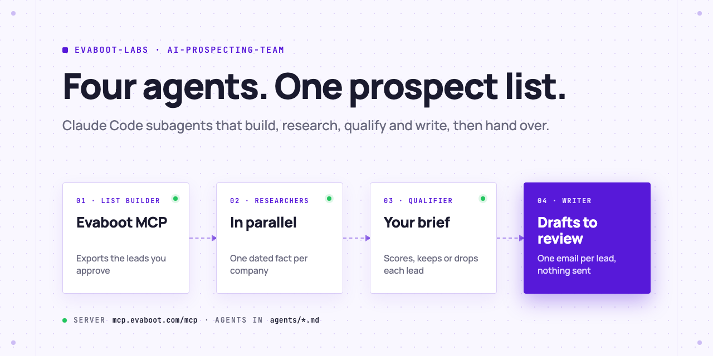
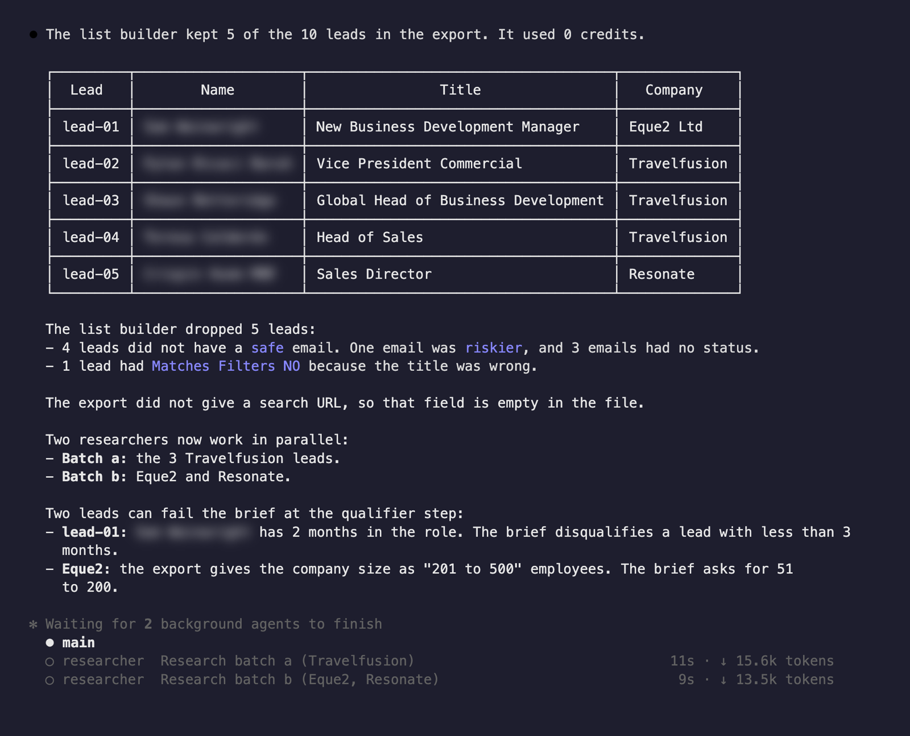
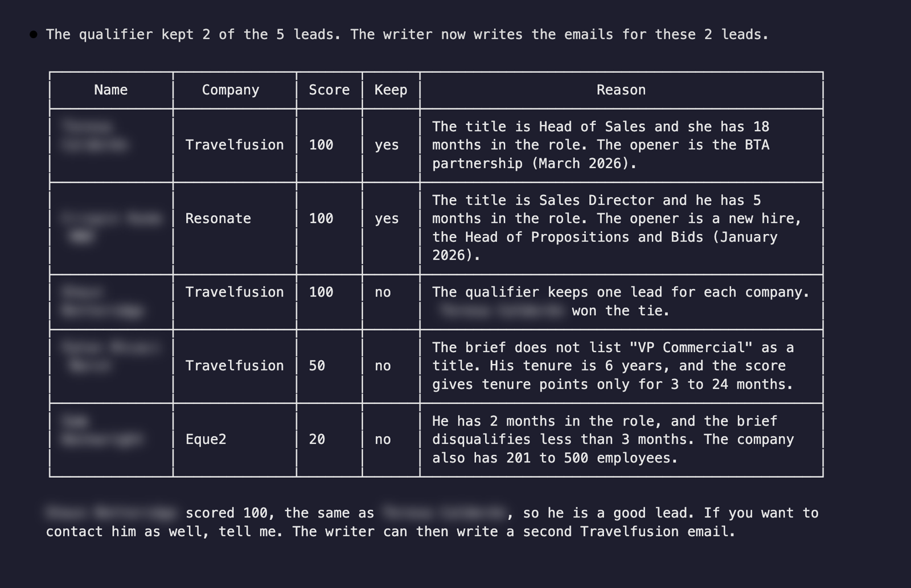
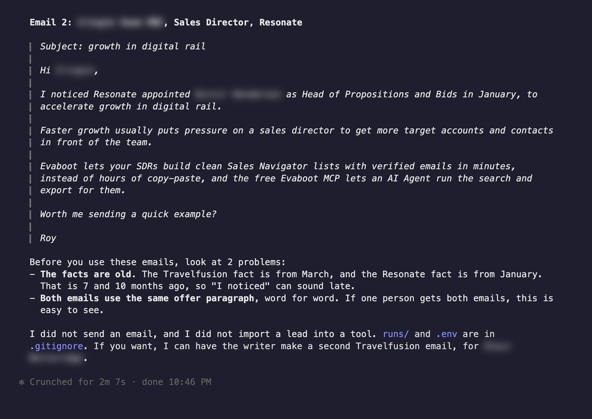

<picture>
  <source media="(prefers-color-scheme: dark)" srcset=".github/assets/banner-dark.png">
  
</picture>

# AI prospecting team

Four Claude Code subagents, one job each. The list builder exports leads from Sales Navigator with Evaboot, researchers find one dated fact per company in parallel, the qualifier scores every lead against your brief, and the writer drafts one email per lead that passed. They hand work to each other through files you can read. Nothing is sent.

[](AGENTS.md)
[](https://evaboot.com/mcp)
[](LICENSE)

## Set it up in one prompt

Paste this into Claude Code:

```text
Clone https://github.com/evaboot-labs/ai-prospecting-team, read AGENTS.md and follow the skill. Run my prospecting team on 10 sales leaders at UK SaaS companies.
```

<details>
<summary>Or install the skill</summary>

Claude Code:

```text
/plugin marketplace add evaboot-labs/ai-prospecting-team
/plugin install ai-prospecting-team@evaboot-labs-ai-prospecting-team
```

Codex, Cursor and other agents:

```bash
npx skills add evaboot-labs/ai-prospecting-team
```

</details>

## How it works

**1. The list builder exports, then hands over.** It is the only agent allowed to spend Evaboot credits, and only the number you approve. It keeps leads that match your filters with a safe email.



**2. Researchers and a qualifier check every lead.** Each researcher has web access only. The qualifier reads files only, and scores role, company, timing and tenure against your brief.



**3. The writer drafts, you review.** One short email per kept lead, opened on the sourced fact, in a CSV for any outreach tool (lemlist, for example).



## What you need

- An [Evaboot account](https://dash.evaboot.com/accounts/signup/?last_click_origin=ai-prospecting-team-repo) and a Sales Navigator seat.
- Claude Code (subagents are a Claude Code feature), or n8n with the workflow in `n8n/`.
- Cost: 1 Evaboot credit per exported lead, plus your Claude usage. Rerunning the team on an export you already have costs no credits.

## Go further

| Page | For |
|---|---|
| [BRIEF.md](BRIEF.md) | The brief all four agents read |
| [docs/agents.md](docs/agents.md) | What each agent may do, and how to change it |
| [docs/connect-your-agent.md](docs/connect-your-agent.md) | The Evaboot MCP, by hand, for each agent |
| [docs/n8n.md](docs/n8n.md) | The same team in n8n |

---

Agents: start at [AGENTS.md](AGENTS.md) · Built by [Evaboot](https://evaboot.com) · More workflows at [github.com/evaboot-labs](https://github.com/evaboot-labs) · [MIT license](LICENSE)
